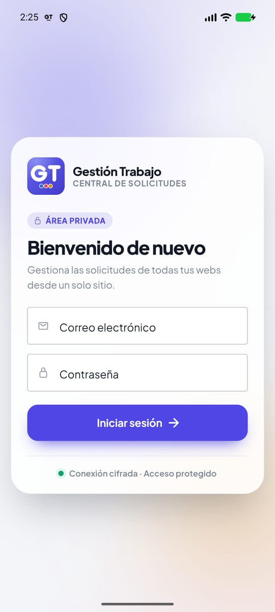
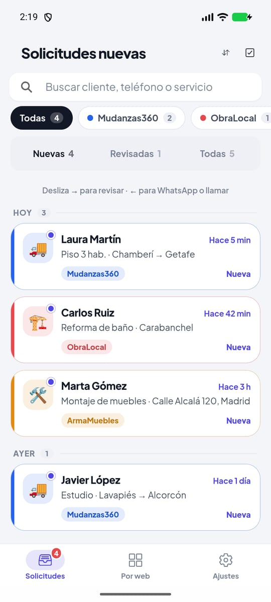
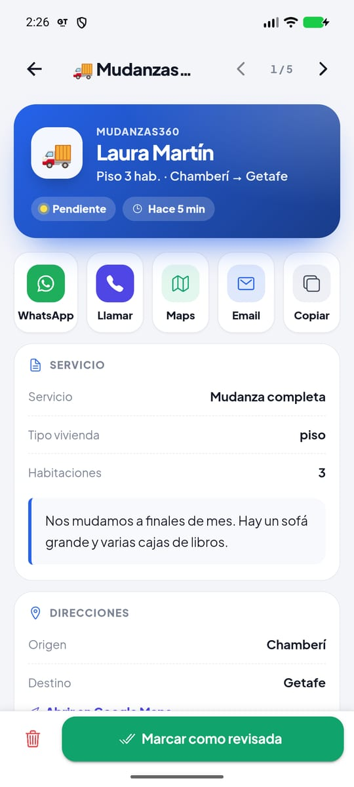
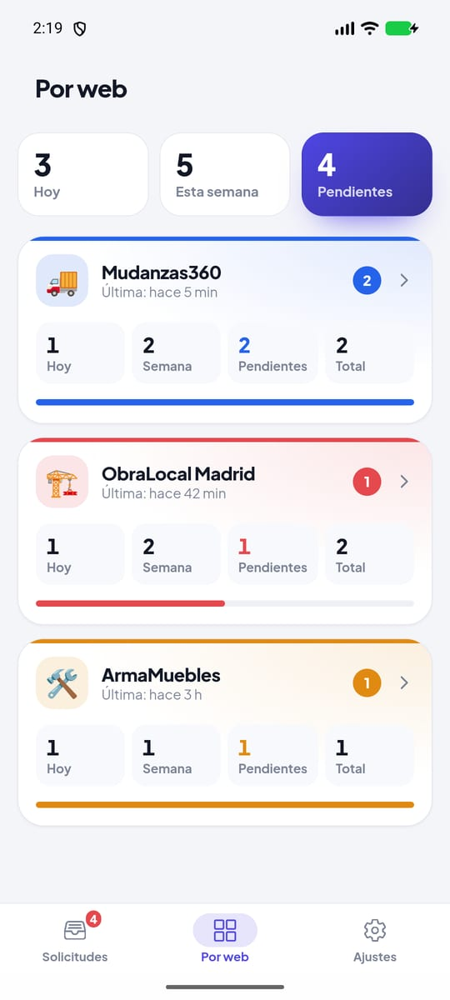
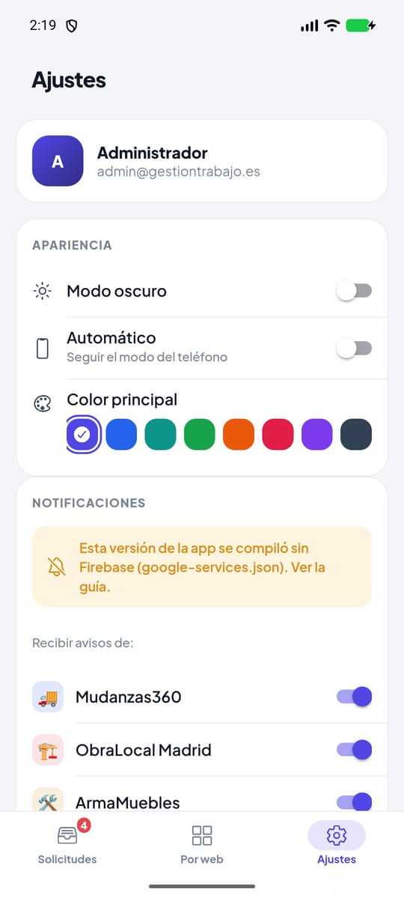
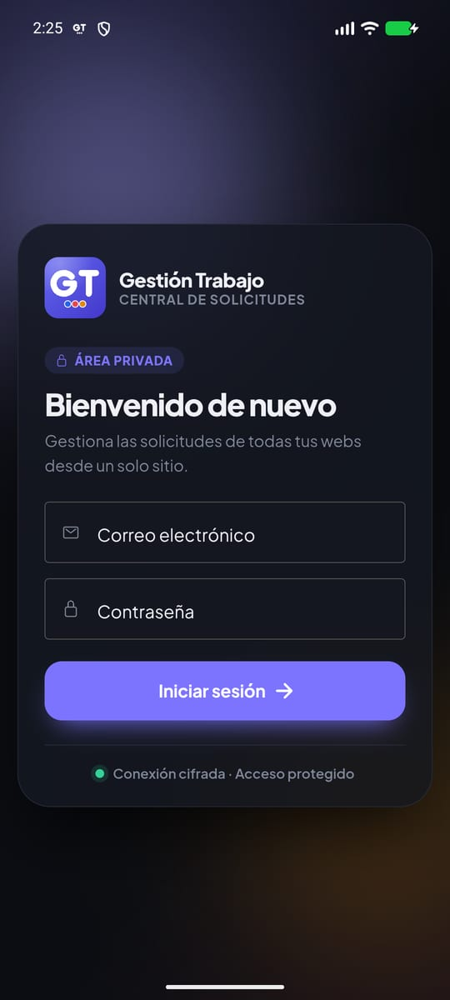
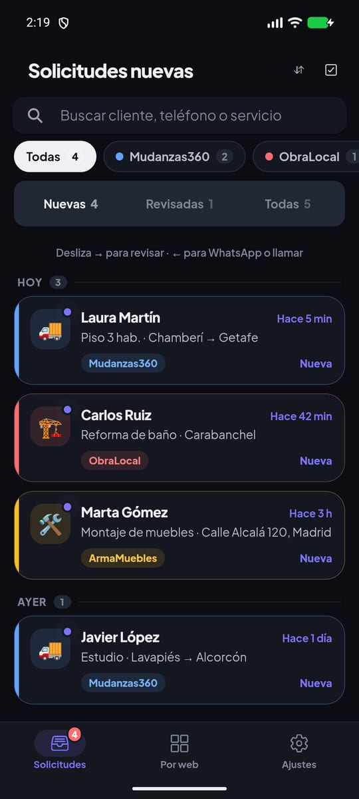
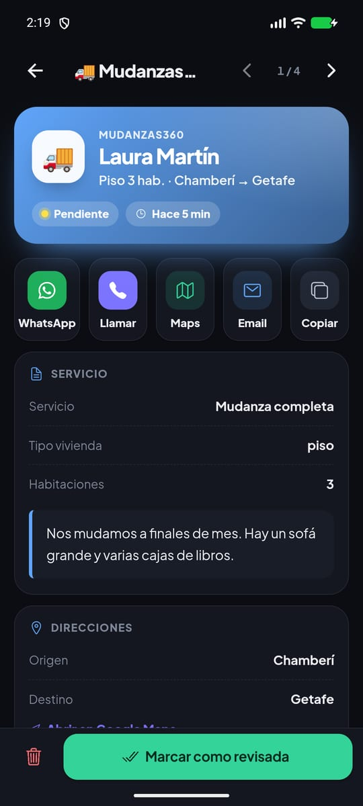
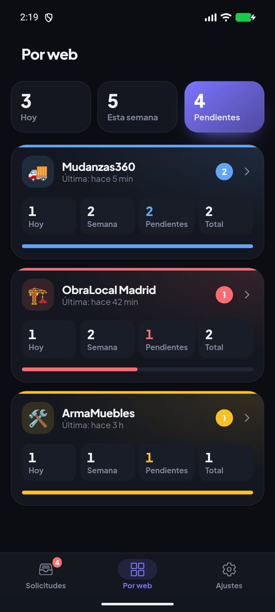
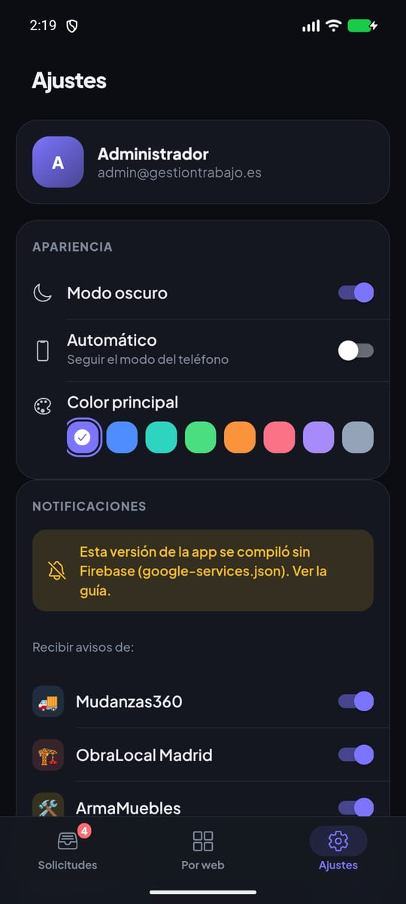

# Gestión Trabajo · Guía para ponerlo en marcha

Esta guía explica, paso a paso, lo que falta para que las **notificaciones push** lleguen al
móvil. Todo lo demás (la app, la web, el diseño y el código de las notificaciones) ya está
hecho en la rama `app-ionic`.

> **Resumen de lo que falta:** crear Firebase (15 min), guardar dos secretos en Supabase
> (5 min), desplegar la función y las migraciones (5 min) y compilar e instalar el APK (10 min).

| Login | Lista | Detalle | Por web | Ajustes |
|---|---|---|---|---|
|  |  |  |  |  |
|  |  |  |  |  |

*(Capturas del APK en el emulador, con datos inventados.)*

---

## Antes de empezar: cómo funciona

```
Web (formulario) ──INSERT──► Supabase: tabla requests
                                   │  trigger (pg_net)
                                   ▼
                     Edge Function notificar-solicitud
                                   │  FCM (Firebase)
                                   ▼
                     Móviles con la app y esa web activada
```

- Las webs **no cambian**: siguen insertando en `requests` igual que siempre.
- Un trigger de la base de datos avisa a la Edge Function, que manda el push a cada móvil
  registrado en la tabla `device_tokens`.
- Si algo de esto falla, **la solicitud se guarda igualmente**: el aviso nunca bloquea un
  formulario.

Necesitas una terminal **PowerShell** abierta en la carpeta del proyecto:

```powershell
cd "C:\Users\Luis\Desktop\APP DE TRABAJO\WEBS DE TRABAJO\GESTION-TRABAJO"
git switch app-ionic
npm install
```

---

## 1. Crear el proyecto en Firebase y añadir la app Android

1. Entra en **https://console.firebase.google.com** con tu cuenta de Google.
2. **Crear un proyecto** → nombre: `gestion-trabajo` → Google Analytics: **no hace falta** →
   **Crear proyecto**.
3. En la página del proyecto pulsa el icono de **Android**, "Añadir app":
   - **Nombre del paquete de Android:** `es.gestiontrabajo.app`. Tiene que ser exactamente este.
   - **Apodo de la app:** `Gestión Trabajo`.
   - **Certificado SHA-1:** déjalo vacío; no hace falta para las notificaciones.
   - **Registrar app**.
4. **Descarga `google-services.json`** y cópialo en:

   ```
   GESTION-TRABAJO\android\app\google-services.json
   ```

   Ese archivo **no se sube a git**: ya está en `.gitignore`.
5. Pulsa **Siguiente** en el resto de pasos del asistente (el proyecto ya incluye el SDK) y
   después **Ir a la consola**.
6. Comprueba que la API está activa: ⚙️ **Configuración del proyecto** → pestaña **Cloud
   Messaging** → "API de Firebase Cloud Messaging (V1)" debe aparecer como **Habilitada**.
   Si no, pulsa los tres puntos → *Administrar API en Google Cloud Console* → **Habilitar**.

> Sin `google-services.json` la app funciona igual. Solo no se registra para recibir push, y
> en Ajustes lo avisa: *"Esta versión de la app se compiló sin Firebase"*.

---

## 2. Guardar los secretos en Supabase

Hacen falta **dos secretos** para la Edge Function y **dos valores en Vault** para el trigger.

### 2.1 La cuenta de servicio de Firebase → `FIREBASE_SERVICE_ACCOUNT`

1. En Firebase: ⚙️ **Configuración del proyecto** → pestaña **Cuentas de servicio** →
   **Generar nueva clave privada** → **Generar clave**. Se descarga un `.json`.
2. **Guárdalo fuera del proyecto**, por ejemplo en `Documentos\secretos\firebase-cuenta.json`.
   Es una contraseña: no lo subas a git ni lo envíes por correo.

### 2.2 Un secreto para el trigger → `WEBHOOK_SECRET`

Genera una cadena aleatoria larga en PowerShell y **cópiala**, porque la vas a usar dos veces:

```powershell
-join ((48..57) + (97..122) | Get-Random -Count 48 | ForEach-Object { [char]$_ })
```

### 2.3 Guardarlos en Supabase (Edge Functions)

**Opción A, desde la web (más fácil):** Supabase → tu proyecto → **Edge Functions** →
**Secrets** → *Add new secret*:

| Nombre | Valor |
|---|---|
| `FIREBASE_SERVICE_ACCOUNT` | El contenido **completo** del `.json` del paso 2.1 (ábrelo con el Bloc de notas, selecciona todo y pega) |
| `WEBHOOK_SECRET` | La cadena del paso 2.2 |

**Opción B, desde la terminal**, con el archivo de ejemplo:

```powershell
Copy-Item supabase\functions\.env.example supabase\functions\.env
notepad supabase\functions\.env     # pega el JSON en UNA línea y tu WEBHOOK_SECRET
npx supabase secrets set --env-file supabase\functions\.env --project-ref obdetimymgchgqnlxbew
Remove-Item supabase\functions\.env  # bórralo después (igualmente está en .gitignore)
```

### 2.4 Guardar la URL y el secreto en Vault (para el trigger)

Supabase → **SQL Editor** → *New query*. Pega esto, **cambia `PEGA_AQUI_TU_WEBHOOK_SECRET`**
por la cadena del paso 2.2 y pulsa **Run**:

```sql
select vault.create_secret(
  'https://obdetimymgchgqnlxbew.supabase.co/functions/v1/notificar-solicitud',
  'notificar_solicitud_url'
);

select vault.create_secret(
  'PEGA_AQUI_TU_WEBHOOK_SECRET',
  'notificar_solicitud_secret'
);
```

Hasta que existan estos dos valores, el trigger no hace nada (y no molesta).

---

## 3. Desplegar la Edge Function y aplicar las migraciones

Con la CLI de Supabase, mediante `npx`, sin instalar nada global:

```powershell
npx supabase login                                   # abre el navegador para autorizar
npx supabase link --project-ref obdetimymgchgqnlxbew

# 1) La función (sin verificación JWT: la protege WEBHOOK_SECRET)
npx supabase functions deploy notificar-solicitud --no-verify-jwt --use-api

# 2) Las migraciones nuevas (te pedirá la contraseña de la base de datos:
#    Supabase → Project Settings → Database → Database password)
npx supabase db push
```

`--use-api` empaqueta la función en los servidores de Supabase, así que no hace falta tener
Docker abierto.

`db push` enseña la lista antes de aplicar. Debe proponer **solo estas dos**:

- `20261111100000_device_tokens.sql` crea la tabla de tokens, con RLS: cada usuario solo ve
  los suyos.
- `20261111100100_notificar_solicitud_trigger.sql` activa `pg_net` y crea el trigger sobre
  `requests`.

Las otras dos (`20261102…` y `20261108…`) ya están aplicadas en tu proyecto y están en la
carpeta solo para que el historial coincida. Si `db push` intentara aplicarlas, **no
continúes** y avísame.

> **Qué cambia en la base de datos:** una tabla nueva (`device_tokens`), una función
> (`registrar_token`) y un trigger sobre `requests`. **No cambia ninguna columna de
> `requests` ni la forma en que las webs envían solicitudes.**

Comprobación rápida en Supabase → **Edge Functions → notificar-solicitud → Logs**: tras una
solicitud nueva verás una línea como
`notificar-solicitud: canal=mudanzas360 dispositivos=1 enviadas=1 fallidas=0 borradas=0`.
Los registros **nunca** incluyen datos del cliente.

---

## 4. Compilar e instalar el APK en el móvil

### 4.1 Compilar

Con `google-services.json` ya en `android\app\`:

```powershell
npm run build:android      # compila la web y la copia a Android (ng build + cap sync)
npm run android            # abre el proyecto en Android Studio
```

En **Android Studio**:

1. La primera vez: **File → Settings → Build, Execution, Deployment → Build Tools → Gradle →
   Gradle JDK** → elige un **JDK 21**. Si no hay ninguno, *Download JDK…* → versión 21 →
   *Eclipse Temurin*. Capacitor 8 necesita la 21: la 17 es demasiado antigua y el JBR 25 de
   tu Android Studio es demasiado nuevo para el Gradle del proyecto.
2. **Build → Build App Bundle(s) / APK(s) → Build APK(s)**.
3. Al terminar, *locate*. El archivo está en:

   ```
   android\app\build\outputs\apk\debug\app-debug.apk
   ```

Sin Android Studio, desde la terminal:

```powershell
$env:JAVA_HOME = "C:\ruta\a\jdk-21"     # un JDK 21
cd android; .\gradlew.bat assembleDebug; cd ..
```

### 4.2 Instalar en el móvil

- **Por cable (lo más rápido):** activa *Opciones de desarrollador → Depuración USB* en el
  móvil, conéctalo y ejecuta:

  ```powershell
  & "$env:LOCALAPPDATA\Android\Sdk\platform-tools\adb.exe" install -r android\app\build\outputs\apk\debug\app-debug.apk
  ```

- **Sin cable:** copia `app-debug.apk` al móvil (Drive, WhatsApp a ti mismo…), ábrelo y
  permite *"Instalar apps desconocidas"* para esa app cuando lo pida.

### 4.3 Primera vez en el móvil

1. Abre **Gestión Trabajo** → inicia sesión.
2. Aparece la pantalla *"Entérate al momento de cada trabajo"* → **Activar notificaciones** →
   **Permitir**.
3. **Ajustes → Notificaciones** debe decir *"Activadas. Este móvil recibirá un aviso por cada
   solicitud nueva."*
4. Pulsa **Enviar notificación de prueba**. Debe llegar al momento.

> El APK de depuración vale para tu propio móvil. Para repartirlo o subirlo a Google Play hace
> falta un APK **firmado** (*Build → Generate Signed App Bundle / APK*). Guarda el archivo
> `.jks` y su contraseña **fuera de git**: si los pierdes, no podrás actualizar la app.

---

## 5. La versión web (Netlify)

- La web ya **no usa SSR**: es una compilación estática configurada en `netlify.toml` (build
  `npm run build`, carpeta `dist/gestion-trabajo/browser`).
- Si en Netlify → *Site configuration → Build & deploy* tenías activado el plugin
  `@netlify/angular-runtime`, **quítalo**: ya no hace falta y se ha eliminado del proyecto.
- En la web no hay notificaciones push. Si el panel está abierto, suena un aviso con el botón
  **Ver** al llegar una solicitud. Los navegadores solo dejan sonar audio después de que hayas
  tocado la página una vez.
- **Ojo:** Netlify publica `main`. Mientras esto siga en la rama `app-ionic`, la web publicada
  no cambia. Cuando lo unas a `main`, se publicará la versión nueva.

---

## 6. Lo que no se ha podido probar (y cómo probarlo tú)

Todo se probó **sin tocar datos reales**: Supabase simulado en el navegador y en el emulador, y
las migraciones sobre un PostgreSQL local.

| Qué | Por qué no se pudo | Cómo comprobarlo |
|---|---|---|
| **Push real de FCM** con la app abierta, en segundo plano y cerrada | Necesita tu proyecto de Firebase. Con avisos **locales** sí se probaron los tres casos en el emulador, y al tocarlos se abre `/solicitud/{id}` | Tras los pasos 1–4: *Ajustes → Enviar notificación de prueba* con la app abierta (debe salir un aviso dentro de la app con **Ver**), en segundo plano y tras cerrarla deslizándola |
| **Trigger y Edge Function en tu proyecto** | No se aplicó nada a producción. Se probaron con 23 comprobaciones en PostgreSQL local y 25 con FCM simulado | Con una solicitud de prueba (abajo) |
| **Tiempo real** (la lista se actualiza sola, aviso con sonido en la web) | No se puede simular sin un Supabase real | Abre la web y crea la solicitud de prueba: debe aparecer sola, con sonido |
| **Copiar al portapapeles** y el **número en el icono** | Dependen del dispositivo | En tu móvil. El número en el icono solo sale en lanzadores que lo admiten (Samsung, Xiaomi…) |
| **Un cierre en el emulador** al mandar la app al fondo | Es un fallo del WebView de pruebas (versión 149) de esa imagen de Android 17, no de la app (`SIGILL` dentro de `libwebviewchromium.so`) | Compruébalo en tu móvil real: si se cerrara al salir de la app, avísame con el modelo y la versión de Android |

### Solicitud de prueba (para probar todo de punta a punta)

Supabase → **SQL Editor**. Crea una solicitud marcada como prueba:

```sql
insert into public.requests (source, name, phone, service, description, details)
values ('mudanzas360', 'Cliente de prueba', '600000000', 'Mudanza completa',
        'Solicitud de prueba: borrar después.',
        '{"is_test": true, "tipo_vivienda": "piso", "habitaciones": 3, "origen": "Chamberí", "destino": "Getafe"}');
```

Debe llegar al móvil: **"🚚 Mudanzas360 · Nueva solicitud"** con el texto
*"Mudanza completa · Piso 3 hab. · Chamberí → Getafe · Cliente de prueba"*. Tócala y se abre
el detalle. Después **bórrala** desde la app (papelera) o con:

```sql
delete from public.requests where details->>'is_test' = 'true' and name = 'Cliente de prueba';
```

Si no llega, revisa en este orden:
1. Supabase → Edge Functions → `notificar-solicitud` → **Logs**.
2. Que existan los dos valores de Vault (paso 2.4).
3. Que en el móvil, en Ajustes, ponga *"Activadas"*.

---

## 7. iOS más adelante

El código ya está preparado (Ionic y Capacitor son multiplataforma). Faltaría:

1. **Un Mac** con Xcode, porque las apps de iPhone solo se compilan en macOS.
2. **Apple Developer Program**: 99 USD al año.
3. En el Mac: `npm install` → `npx cap add ios` → `npm run build && npx cap sync ios` →
   abrir en Xcode.
4. En Apple Developer, crear una **clave APNs** (`.p8`) y subirla a Firebase → Configuración
   del proyecto → Cloud Messaging → *Configuración de la app de Apple*.
5. Añadir una app **iOS** en Firebase (mismo id `es.gestiontrabajo.app`) y poner su
   `GoogleService-Info.plist` en Xcode.
6. En Xcode: *Signing & Capabilities* → **Push Notifications** y **Background Modes → Remote
   notifications**.

La Edge Function no cambia: FCM reenvía a Apple. Solo habría que registrar los tokens con
`plataforma = 'ios'`, algo que la app ya hace sola.

---

## Referencia rápida

| Qué | Dónde |
|---|---|
| Nombres, colores, emojis y canales de cada web (**un único sitio**) | `supabase/functions/_shared/webs.ts` |
| Texto de las notificaciones y resúmenes de las tarjetas | `supabase/functions/_shared/resumen.ts` |
| Edge Function | `supabase/functions/notificar-solicitud/index.ts` |
| Migraciones | `supabase/migrations/` |
| Servicio de notificaciones de la app | `src/app/servicios/notificaciones.service.ts` |
| Logo (regenerar iconos con `npm run assets`) | `scripts/generar-logo.mjs`, `assets/` |
| Inventario de funciones y comprobaciones | `MIGRACION.md` |
